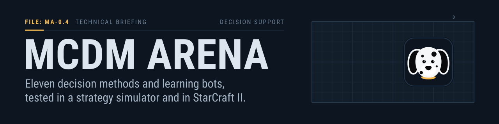

<picture>
  <source media="(prefers-color-scheme: dark)" srcset="assets/mcdm-arena-banner-dark.svg">
  <source media="(prefers-color-scheme: light)" srcset="assets/mcdm-arena-banner-light.svg">
  
</picture>

<p>
  <a href="../../releases/latest"></a>
  
  <a href="EULA.txt"></a>
  
  
</p>

**[Download the latest version](../../releases/latest)** &nbsp;|&nbsp; [Release notes](../../releases) &nbsp;|&nbsp; [Licence](#08-licence) &nbsp;|&nbsp; [Privacy](PRIVACY.md)

## 01 Overview

MCDM Arena is a Windows application for comparing multi-criteria decision-making (MCDM) methods under pressure. Eleven methods, among them SAW, TOPSIS and VIKOR, and learning bots play a strategy-game simulator modelled on StarCraft II, and the real game through pysc2.

Every decision is recorded with the criteria, the weights and the ranking behind it, so a replay shows why a method chose what it chose, and where two methods disagree. A Crisis Lab carries the same structure over to crisis-management scenarios.

MCDM Arena is closed source; the installer and the portable version are published here.

## 02 What it does

| Area | What you get |
| --- | --- |
| **Play** | Games between methods, bots and built-in opponents, in the built-in simulator or in real StarCraft II (pysc2). The simulator needs no StarCraft II installation. |
| **Replay** | Each game step by step. For every decision: the options, the criteria and weights, the ranking, and why the winner won. |
| **Learning bots** | Bots that learn from their games which method and which weighting of the criteria to use in which situation. The decision itself is still made by an MCDM method, so it stays explainable. Training runs are tracked generation by generation. |
| **Statistics** | Who wins against whom, what each method would have chosen on the same decisions, how often two methods agree, and which game factors go with winning. |
| **Compare** | A fair comparison: several players against the same opponents with the same number of games, with the win rates side by side. |
| **Crisis Lab** | Crisis-management scenarios built from the structure of game decisions, ranked by all methods, with a check of how robust each recommendation is. Synthetic data only. |
| **Report** | Results exported as PDF or LaTeX. |
| **Teams** (beta) | Share bots, comparison results, Crisis Lab sets and game summaries with a small team. Optional; see [05](#05-teams-beta). |

<details>
<summary><b>The eleven methods</b></summary>

| Method | Family | In one line | Reference |
| --- | --- | --- | --- |
| SAW | scoring | Weighted sum of normalised values; simple and fully compensatory. | Hwang & Yoon (1981) |
| TOPSIS | distance | Closest to the ideal and farthest from the anti-ideal solution. | Hwang & Yoon (1981) |
| VIKOR | compromise | Compromise between group utility and the worst individual regret. | Opricovic & Tzeng (2004) |
| WPM | scoring | Weighted product; one very poor value cannot be compensated. | Triantaphyllou (2000) |
| WASPAS | scoring | Blend of weighted sum and weighted product. | Zavadskas et al. (2012) |
| COPRAS | ratio | Benefits and costs assessed separately, proportionally. | Zavadskas, Kaklauskas & Sarka (1994) |
| EDAS | distance | Distance from the average alternative instead of an ideal one. | Keshavarz Ghorabaee et al. (2015) |
| MOORA | ratio | Ratio system: weighted benefits minus weighted costs. | Brauers & Zavadskas (2006) |
| PROMETHEE II | outranking | Pairwise outranking; ranks by net preference flow. | Brans & Vincke (1985) |
| ARAS | ratio | Utility relative to an optimal alternative. | Zavadskas & Turskis (2010) |
| Consensus (Borda) | ensemble | Borda count over several methods. | Borda (1781) |

</details>

## 03 Download

Get the latest version from **[Releases](../../releases/latest)**:

- **Installer:** `MCDM-Arena-Setup-<version>.exe`. Installs for your user only; no administrator rights needed.
- **Portable:** `MCDM-Arena-Portable-<version>.zip`. Extract all files first (right-click, **Extract All**), then start the program from the extracted folder. Nothing is installed.

**Windows may warn on first start** ("Windows protected your PC"), because the program is not yet code-signed. Click **More info → Run anyway**.

Each release lists SHA-256 checksums in `SHA256SUMS.txt`. To check your download in PowerShell:

```powershell
Get-FileHash .\MCDM-Arena-Setup-<version>.exe -Algorithm SHA256
```

## 04 Requirements

- Windows 10 or 11, 64-bit.
- Everything the app needs is included.
- StarCraft II (the free Starter Edition is enough) only for real StarCraft II games. The built-in simulator works without it.

## 05 Teams (beta)

Teams let a small group share bots, comparison results, Crisis Lab sets and game summaries through an online service. They are optional: without a team, nothing leaves your computer. What the service keeps, and how to have it deleted, is in the [privacy notice](PRIVACY.md).

Teams are invite only during the beta. To join, write to mcdm.arena@gmail.com.

## 06 Updates & data

The app tells you when a new version is available and links here; it does not update itself. Installing a new version over the old one keeps all your games, bots and settings.

| Copy | Where your data lives |
| --- | --- |
| Installed | `%LOCALAPPDATA%\MCDMArena`. Installing and uninstalling never touch it. |
| Portable | A `data` folder next to the program, because the portable copy carries a `portable.flag` file. Move the folder and your data moves with it. |

## 07 How to cite

If you use MCDM Arena in academic work, please cite it as software:

```bibtex
@software{solic_mcdm_arena_2026,
  author  = {{\v{S}}oli{\'c}, Tin},
  title   = {{MCDM Arena}},
  version = {0.4.1},
  year    = {2026},
  url     = {https://github.com/dev1ce2004/mcdm-arena},
  note    = {Windows application}
}
```

Šolić, T. (2026). *MCDM Arena* (Version 0.4.1) [Computer software]. https://github.com/dev1ce2004/mcdm-arena

## 08 Licence

**MCDM Arena is proprietary software.**

Copyright © 2026 Tin Šolić. All rights reserved.

All rights, title and interest in and to MCDM Arena, including its original source code, architecture, interface, documentation and associated materials, are reserved by the copyright holder, except for components identified as third-party software.

No part of MCDM Arena may be copied, modified, redistributed, sublicensed, reverse-engineered or commercially exploited without prior written permission, except where expressly permitted by applicable law or the applicable third-party licence.

Use of MCDM Arena is subject to the [End-User Licence Agreement (EULA)](EULA.txt).

- [Privacy notice](PRIVACY.md): what the optional team service keeps and how to have it deleted. Without a team, nothing leaves your computer.
- [Third-party notices](THIRD-PARTY-NOTICES.txt): the open-source components inside the app and their licences.

## 09 Notices

StarCraft II is a trademark of Blizzard Entertainment, Inc. MCDM Arena is an independent project and is not affiliated with, endorsed by, or sponsored by Blizzard Entertainment.

Questions and team requests: mcdm.arena@gmail.com
